  

  

  

### 🔥 About me

I'm Davi, from Brazil. Day to day I manage **Kubernetes** clusters and **Linux** servers, build **GitLab CI/CD** pipelines and help teams solve infrastructure problems.

I also build web frontends with **Next.js**, **React** and **TypeScript**: landing pages, sites and dashboards, from the first commit to the cluster they run on.

> 🎧 [**Levanta e Anda**, Emicida (part. Rael)](https://www.youtube.com/results?search_query=Emicida+Levanta+e+Anda+Rael)

### 🛠️ What I work with

### ⚔️ Projects

| | Project | What it is |
|---|---|---|
| 🏠 | [**homelab**](https://github.com/davinnsc/homelab) | Proxmox + K3s built with Terraform, rebuilt as RKE2 by hand, and every incident on the way |
| 📈 | [**infra-monitor-api**](https://github.com/davinnsc/infra-monitor-api) | FastAPI host metrics in JSON and Prometheus, Docker stack with a Grafana dashboard |
| 🌐 | [**terraform-azure-hub-spoke**](https://github.com/davinnsc/terraform-azure-hub-spoke) | Hub-and-spoke on Azure: firewall egress and AKS with `userDefinedRouting` |
| 📶 | [**vivo-wifi-split**](https://github.com/davinnsc/vivo-wifi-split) | Splits 2.4 / 5 GHz Wi-Fi on Vivo Fibra modems. Double-click and done |
| 🧹 | [**disable-windows-services**](https://github.com/davinnsc/disable-windows-services) | Turns off telemetry, Recall and friends on Windows. With undo |

### 🐉 Activity

  

<b>🇧🇷 Versão em português</b>

 

Sou o Davi, do Brasil. No dia a dia gerencio clusters **Kubernetes** e servidores **Linux**, monto pipelines no **GitLab CI/CD** e ajudo times a resolver problemas de infraestrutura.

Também construo frontends com **Next.js**, **React** e **TypeScript**: landing pages, sites e dashboards, do primeiro commit até o cluster onde rodam.

Os projetos acima têm README em inglês e português.

  

